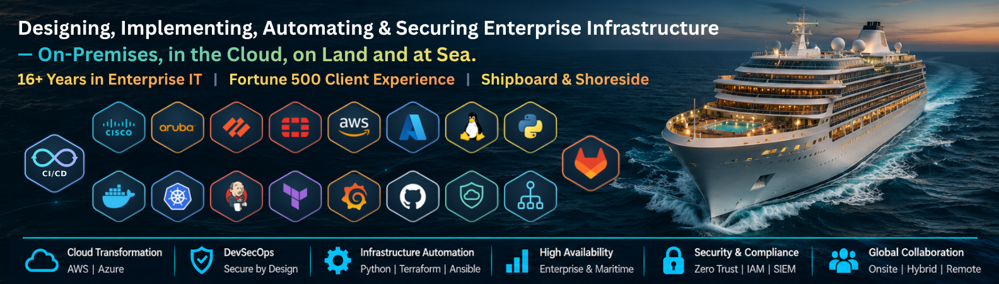

# Hi, I'm Himanshu Saini 👋

## Technology Professional

### Multi-Cloud & DevOps Engineering | Enterprise Networking | Cybersecurity | AI Automation

> Designing, Implementing, Automating and Securing Enterprise Infrastructure — On-Premises, in the Cloud, on Land and at Sea.

## About Me

- 16+ years of Enterprise IT Infrastructure experience.
- Principal Engineer with a background in Enterprise Networking and Security.
- Experience supporting global enterprise and Fortune 500 clients.
- International onsite infrastructure implementation experience.
- Experience in large-scale shipboard and shoreside infrastructure.
- Currently developing hands-on expertise in Multi-Cloud, DevOps and DevSecOps.
- Passionate about Infrastructure Automation and AI-powered IT Operations.

## Professional Expertise

- Enterprise Routing and Switching
- Network Security and Secure Connectivity
- Linux System Administration
- Infrastructure Implementation and Migration
- High Availability and Network Resilience
- Infrastructure Automation
- ITIL Change Management

## Cloud & DevOps Learning and Projects

## Project Roadmap

| Project | Technology |
|---|---|
| AWS Infrastructure Automation | AWS, Terraform |
| Hybrid Cloud Networking | AWS, BGP, IPsec |
| Azure Infrastructure | Azure, Terraform |
| Enterprise Network Automation | Python, Ansible |
| Automated CI/CD Pipeline | Jenkins, Docker, Kubernetes |
| Secure DevSecOps Pipeline | SonarQube, Trivy, Checkov |
| Linux Infrastructure Automation | Linux, Bash |
| AI Infrastructure Automation | Python, AI |

## Professional Focus

Enterprise Infrastructure → Cloud Engineering → DevOps → DevSecOps → AI Automation

## Connect With Me

- Website: https://himanshusaini.in
- GitHub: https://github.com/Er-HimanshuSaini
